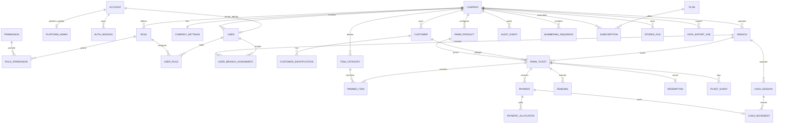

# PawnPilot — Project Plan and Status

> Single source of truth for scope, architecture, decisions, and phase progress.
> Update this file at the end of every work session.

| Field | Value |
|---|---|
| Last updated | 2026-10-28 |
| Current phase | **Phase 1 complete locally; awaiting review. Phase 2 not started.** |
| Pilot customer | Jerome's Pawnshop (branch count and workflows to be verified) |
| Repository | `\\wsl.localhost\Debian\home\zane\Projects\PawnPilot` |
| Primary stack | Next.js 16 / React 19 / TypeScript 5.9 (web) · NestJS 12 ESM / TypeScript 6 (API) / PostgreSQL 17 / Prisma 6.19.3 |
| Production posture | Web-first, online-first, multi-tenant SaaS |

**Approval gate:** Phase 1 was approved and implemented. Phase 2 must not begin until Phase 1 is reviewed and the open decisions in sections 11 and 12 are confirmed. Phase 4 must not begin until the financial rules in section 7.1 are confirmed. Phase 1 verification is local; the GitHub Actions workflow has not run on a remote repository.

---

## 0. Status dashboard

| Phase | Status | Notes |
|---|---|---|
| Phase 0 — Discovery | **Complete** | Repository inspected; architecture, ERD, API map, role matrix, rules, and testing plan documented. |
| Phase 1 — Foundation | **Complete locally** | Monorepo, API, database, web shell, tests, and CI workflow implemented. Local gates pass; remote CI not yet run. Awaiting review. |
| Phase 2 — Authentication and tenancy | Not started | Blocked by Phase 1 review and the open decisions in section 12. |
| Phase 3 — Customers and items | Not started | Blocked by Phase 2. |
| Phase 4 — Core pawn workflow | Not started | Blocked by Phase 3 and financial-rule confirmation. |
| Phase 5 — Payments, renewals, redemption | Not started | Blocked by Phase 4. |
| Phase 6 — Dashboards and reports | Not started | Blocked by Phase 5. |
| Phase 7 — Pilot hardening | Not started | Blocked by Phase 6. |
| Phase 8 — Controlled rollout | Not started | Blocked by Phase 7. |
| Phase 9 — SaaS readiness | Not started | Blocked by Phase 8. |

Status legend: `Not started` · `In progress` · `Blocked` · `Complete` · `Complete locally` · `Deferred`.

---

## 1. Product summary

PawnPilot is a production-oriented, multi-tenant pawnshop management SaaS for the Philippine market.

Initial goals:

- Let a pawnshop owner monitor all authorized branches.
- Let branch operators handle customer registration, appraisal, pawn transactions, payments, renewals, redemptions, receipts, and branch reports.
- Let head-office staff manage users, settings, and consolidated reporting.
- Keep each subscribing company's data isolated.
- Let the SaaS operator manage subscriptions and platform health without casual access to tenant financial records.
- Work on desktop and tablet, with a usable mobile layout.
- Keep business rules in the backend, with every sensitive action permission-controlled and auditable.

Initial scope is web-first and online-first. Offline operation, hardware integrations, and advanced accounting are not assumed.

---

## 2. Repository assessment

The Phase 0 baseline is preserved in git commit `d1b2437`. Current state after Phase 1:

| Area | Current finding |
|---|---|
| Version control | Git repository on `main`. Baseline commit `d1b2437`; Phase 1 commit follows verification. |
| Application | npm-workspaces monorepo: `apps/web`, `apps/api`, `packages/api-client`. |
| Frontend | Next.js `16.4.3`, React `19.3.0`, App Router, Tailwind CSS `4.3.3`. |
| Backend | NestJS `12.3.2` modular monolith, native ESM, port `3001`. |
| Language | Web TypeScript `5.9.3`; API TypeScript `6.0.2`; both `strict: true`. |
| Database / ORM | PostgreSQL `17`; Prisma `6.19.3`; initial migration applied. |
| Authentication | Not implemented. Planned for Phase 2. |
| Tests / CI | Vitest unit tests, API end-to-end tests, ESLint, Prettier, and GitHub Actions workflow. |
| Source files | Foundation web shell, NestJS health/OpenAPI API, Prisma schema/migration/seed. |
| Local database path | `infra/docker-compose.yml`; this WSL environment lacks the Compose plugin, so verification used `docker run postgres:17-alpine`. |
| Baseline lint / build | Both pass inside WSL after Phase 1. |
| Runtime | WSL Debian: Node `24.22.0`, npm `11.19.1`, Docker `26.1.5`, git `2.47.3`. |

Remaining constraints:

1. **Next.js 16 is materially different.** Use the bundled docs at `node_modules/next/dist/docs/` before changing routing, caching, or server behavior.
2. **NestJS 12 is ESM-only.** API source uses `"type": "module"`, TypeScript `nodenext`, explicit `.js` extensions on relative imports, and Vitest. Do not introduce CommonJS-only test tooling.
3. **WSL/UNC issue.** Running `npm` from Windows PowerShell on the UNC path fails because `CMD.EXE` cannot use UNC paths. Run all development commands inside WSL.
4. **Prisma 6 is deliberately pinned.** Prisma 7's new contract/configuration format and driver adapters need a separate migration spike. The temporary `deepmerge-ts@8.0.2` override must be revisited with any Prisma upgrade.
5. **Compose plugin may be absent.** The compose file is the documented path; environments without the plugin need it installed or an equivalent PostgreSQL container.
6. **Remote CI is unverified.** The workflow exists, but no remote repository has executed it yet.
7. **No authentication or financial data exists.** Phase 1 is infrastructure only.

---

## 3. Proposed architecture

### 3.1 Shape

```text
Browser
  │
  │ HTTPS, same origin
  ▼
app.example.com
  ├── /                 → Next.js web frontend
  └── /api/v1/*         → NestJS REST API
                              │
                              ├── PostgreSQL (Prisma)
                              ├── S3-compatible private file storage
                              ├── Redis (rate limits / jobs, production)
                              └── Transactional email provider
```

One authoritative NestJS API and PostgreSQL database. The frontend never connects to PostgreSQL. Tenant identity is derived from the session, never from a client-supplied `companyId`.

### 3.2 Monorepo

```text
pawnpilot/
├── apps/
│   ├── web/                 # Next.js 16 frontend
│   │   ├── .env.example
│   │   └── ...
│   └── api/                 # NestJS 12 ESM modular monolith
│       ├── prisma/          # schema, migrations, seed
│       ├── src/
│       ├── test/
│       ├── .env.example
│       └── ...
├── packages/
│   └── api-client/          # generated OpenAPI types
├── infra/
│   └── docker-compose.yml   # local PostgreSQL
├── docs/
│   └── adr/                 # architecture decision records
├── .github/workflows/ci.yml
├── .nvmrc
├── package.json             # npm workspaces
└── package-lock.json
```

Use **npm workspaces** because npm is installed and a lockfile exists. Avoid Turborepo/Nx initially.

### 3.3 Stack decisions

| Layer | Position | Phase 1 status |
|---|---|---|
| Frontend | Next.js `16.4.3` App Router + React `19.3.0` + TypeScript `5.9.3` | Implemented |
| UI | Tailwind CSS `4.3.3` now; shadcn/ui (Radix primitives) in Phase 2 | Partially implemented |
| Server state | TanStack Query | Planned for Phase 2+ |
| Forms | React Hook Form + Zod | Planned for Phase 2+ |
| Tables | TanStack Table | Planned for Phase 2+ |
| API client | `openapi-typescript` + `openapi-fetch` | Package scaffolded; generation in Phase 2 |
| Backend | NestJS `12.3.2` modular monolith, native ESM | Implemented |
| Runtime | Node 24, npm 11, npm workspaces | Implemented |
| Validation | `class-validator` + global `ValidationPipe` | Implemented |
| ORM | Prisma `6.19.3` pinned; Prisma 7 migration is a separate spike | Implemented |
| Database | PostgreSQL 17 locally; managed PostgreSQL in production | Implemented locally |
| Auth | Opaque server-side sessions, Argon2id, TOTP MFA, separate platform-admin realm | Planned for Phase 2 |
| Files | S3-compatible private bucket | Planned |
| Jobs | Redis-backed queue in production | Planned |
| API docs | OpenAPI generated from NestJS | Implemented |
| Testing | Vitest + Supertest | Implemented |

### 3.4 Backend modules

| Module | Responsibility |
|---|---|
| `AuthModule` | Tenant login, platform login, sessions, MFA, password reset, invitations. |
| `TenancyModule` | Company/branch context, branch access, tenant guards. |
| `PlatformModule` | Company provisioning, plans, subscriptions, platform health, platform audit. |
| `UsersModule` | Tenant users, role assignments, branch assignments. |
| `CustomersModule` | Customer records, identification records, duplicate review, notes. |
| `CatalogModule` | Item categories and pawn products. |
| `PawnTicketsModule` | Quotes, ticket creation, items, numbering, disbursement, state transitions. |
| `PaymentsModule` | Payments, allocations, receipts, reversals. |
| `RenewalsModule` | Renewal quotes and renewal events. |
| `RedemptionsModule` | Redemption quotes, payment/release workflow. |
| `CashModule` | Cash sessions and cash reconciliation, if confirmed. |
| `ReportsModule` | Defined reports, exports, reconciliation. |
| `AuditModule` | Append-only audit events and audit queries. |
| `FilesModule` | Private uploads, signed downloads, retention. |
| `JobsModule` | Async exports, email, cleanup. |
| `HealthModule` | Liveness/readiness. |
| `CommonModule` | Config, logging, errors, idempotency, numbering, money/date utilities. |

Business rules live in services/domain functions, not controllers or React components. Cross-module access goes through services, not another module's tables.

### 3.5 Request pipeline

```text
Request
 → TLS / reverse proxy
 → security headers, body limit, rate limit
 → session authentication guard
 → realm check (tenant vs platform)
 → tenant context (derived from session)
 → permission guard
 → branch-access guard
 → DTO validation
 → service / domain logic
 → Prisma transaction
 → audit event (same transaction where possible)
 → response mapper (no sensitive fields)
 → centralized exception filter
```

Rules:

- Never trust `companyId` from the client. Tenant requests derive it from the session.
- Platform endpoints live under `/api/v1/platform/*` and use a separate session cookie and guard.
- Every branch-scoped request validates the branch against the user's accessible branches.
- Financial mutations run in an explicit PostgreSQL transaction, with row locks and idempotency.
- Controllers never return Prisma models directly; explicit response DTOs prevent field leakage.

### 3.6 Frontend shape

```text
app/
├── (auth)/
│   ├── login/
│   ├── forgot-password/
│   ├── reset-password/
│   └── accept-invitation/
├── (app)/
│   ├── layout.tsx          # server auth gate + app shell
│   ├── dashboard/
│   ├── customers/
│   ├── tickets/
│   ├── payments/
│   ├── reports/
│   ├── settings/
│   └── audit/
└── (platform)/
    └── platform/           # separate platform-admin layout
```

- The `(app)` layout performs a server-side `/auth/me` call with the forwarded cookie, redirects on `401`, and passes narrow user context to client providers.
- All list/detail data is fetched through TanStack Query using the generated client.
- The app uses `/api/v1` on its own origin via a Next rewrite or production reverse proxy, so authentication cookies stay first-party.
- Money calculations are **not** duplicated in the browser. The frontend calls a backend quote endpoint, displays the returned terms, and submits the quote hash with the create request. The backend recomputes and persists the final terms.
- Branch context is held in the URL (`?branch=`) and validated on the server. "All branches" is available only to users with company-wide access and only on aggregate pages.
- Navigation is permission-aware, but the server is the enforcement point.

### 3.7 Deployment proposal

- **Local:** Docker Compose PostgreSQL; optional MinIO and Redis.
- **Staging and production:** separate managed PostgreSQL, object bucket, and secrets.
- **Region:** Singapore (closest common managed region) unless Philippine data-residency advice requires otherwise.
- **Hosting:** managed container host for the API, managed platform for Next.js, or both behind one reverse proxy. One public origin so cookies remain first-party.
- **Backups:** automated daily backups plus point-in-time recovery where supported; encrypted; quarterly restore drill.
- **Monitoring:** structured logs, Sentry, uptime checks, database metrics, backup-failure alerts.
- **CI/CD:** GitHub Actions; migrations run as a controlled release step; no production deploy or real-data migration without explicit approval.

Do not implement offline mode, a local sync engine, or direct hardware integrations until connectivity, printers, scanners, and cash-drawer requirements are verified.

### 3.8 Architecture decisions

1. **Implemented:** Monorepo with `apps/web`, `apps/api`, and `packages/api-client`.
2. **Implemented:** Next.js remains the React frontend; NestJS is the only backend.
3. **Implemented:** Prisma + PostgreSQL, with Prisma pinned to `6.19.3` for Phase 1.
4. **Proposed for Phase 2:** Separate tenant-user and platform-admin authentication realms.
5. **Proposed for Phase 2:** Opaque server-side sessions in PostgreSQL, not JWT in browser storage.
6. **Implemented:** Same-origin API routing through the web domain.
7. **Implemented:** Next `cacheComponents` and `partialPrefetching` are disabled for the pilot.
8. **Proposed for Phase 2:** App-level tenant authorization plus composite database foreign keys first; RLS as a tested backstop.
9. **Implemented:** NestJS 12 ESM runtime with TypeScript `nodenext` and Vitest.
10. **Implemented:** Per-application environment files with committed `.env.example` templates.

---

## 4. Proposed data model

### 4.1 ERD



Additional tables not shown: `INVITATION`, `PASSWORD_RESET_TOKEN`, `MFA_RECOVERY_CODE`, `IDEMPOTENCY_KEY`, `PAYMENT_REVERSAL`, `TRANSACTION_ADJUSTMENT`, `BRANCH_SETTINGS`, `PLATFORM_AUDIT_EVENT`, `PLATFORM_ROLE`.

### 4.2 Tenant ownership invariants

Every tenant-owned table has `company_id`. Every branch-scoped table also has `branch_id`.

Composite foreign keys enforce ownership in the database, not only in application code. Example:

```text
branches   UNIQUE (company_id, id)
customers  UNIQUE (company_id, id)
pawn_tickets
  FOREIGN KEY (company_id, branch_id)   REFERENCES branches(company_id, id)
  FOREIGN KEY (company_id, customer_id) REFERENCES customers(company_id, id)
payments
  FOREIGN KEY (company_id, ticket_id)   REFERENCES pawn_tickets(company_id, id)
```

This prevents a payment, ticket, or item from referencing another company's branch, customer, or ticket even if an application check is missed.

`ACCOUNT` is the login identity. `USER` is the tenant profile; `PLATFORM_ADMIN` is a separate platform profile. This avoids a nullable `company_id` on the user table and prevents a platform account from accidentally satisfying tenant-user checks.

### 4.3 Financial integrity invariants

- `pawn_tickets.id` is a UUID. `ticket_number` is a separate human-readable number with a unique company/branch constraint.
- Completed financial records are never deleted or silently edited.
- Payments are append-only; reversals are separate records linked to the original payment.
- Renewals and redemptions are separate events linked to the ticket.
- `ticket_events` records lifecycle transitions. Maturity/overdue state is derived from dates, not stored as a stale mutable status.
- Ticket terms are snapshotted on the ticket and on each renewal: rate, term, fees, rounding, calculation version, and maturity.
- Balances are derived from immutable financial events. A cached projection is only added if performance testing requires it, and it must be reconciled against events.
- `numbering_sequences` is locked and incremented inside the ticket/payment transaction.
- `audit_events` is append-only and contains actor, tenant, branch, action, target, timestamp, reason, and request ID, with sensitive values redacted.
- Monetary columns use PostgreSQL `NUMERIC`; rates use explicit precision; the API serializes decimals as strings. No binary floating-point for money.
- Business dates are stored as `date`; event timestamps as `timestamptz`; the company timezone is `Asia/Manila` unless confirmed otherwise.

### 4.4 Key entities

| Entity | Purpose |
|---|---|
| `ACCOUNT` | Email/username, password hash, MFA state, lockout state. |
| `USER` | Tenant profile, company, display name, branch-access scope, status. |
| `PLATFORM_ADMIN` | Platform profile; no tenant ownership. |
| `ROLE`, `PERMISSION` | Tenant RBAC. Roles are company-scoped; permissions are a fixed catalog. |
| `COMPANY`, `BRANCH` | Tenant and branch hierarchy. |
| `CUSTOMER`, `CUSTOMER_IDENTIFICATION` | Customer record and masked/encrypted identification details. |
| `PAWN_PRODUCT` | Versioned financial terms: rate, term, fees, rounding, grace period. |
| `PAWN_TICKET` | Contract aggregate and current lifecycle state. |
| `PAWNED_ITEM` | Collateral, appraisal, custody status, photos. |
| `PAYMENT`, `PAYMENT_ALLOCATION` | Payment event and explicit allocation to fees/interest/principal. |
| `RENEWAL`, `REDEMPTION` | Contract events with preserved prior/new terms. |
| `PAYMENT_REVERSAL`, `TRANSACTION_ADJUSTMENT` | Controlled corrections, never deletion. |
| `CASH_SESSION`, `CASH_MOVEMENT` | Drawer reconciliation and cash ledger, if confirmed. |
| `NUMBERING_SEQUENCE` | Atomic human-readable document numbers. |
| `AUDIT_EVENT` | Append-only audit trail. |
| `SUBSCRIPTION_PLAN`, `SUBSCRIPTION` | Manual platform subscription administration. |

**Phase 1 implementation:** only `COMPANY` and `BRANCH` exist in the Prisma schema and initial
migration. Every other entity above is planned and must not be treated as implemented.

---

## 5. API surface

All business endpoints are under `/api/v1`. Health endpoints are outside the versioned API. The API is JSON-only, documented with OpenAPI, and generated into the web client.

**Phase 1 implementation:** only `GET /api/v1` metadata and `GET /health/live` / `GET /health/ready`
exist. The endpoint map below is the target design for later phases, not current behavior.

| Module | Base path | Major endpoints |
|---|---|---|
| Auth — tenant | `/api/v1/auth` | `POST /login`, `POST /logout`, `GET /me`, `POST /password/forgot`, `POST /password/reset`, `POST /password/change`, `POST /mfa/enroll`, `POST /mfa/verify`, `POST /mfa/disable`, `POST /reauth`, `GET /sessions`, `DELETE /sessions/:id` |
| Auth — invitations | `/api/v1/auth` | `POST /invitations/accept`, `GET /invitations/:token` |
| Auth — platform | `/api/v1/platform/auth` | `POST /login`, `POST /logout`, `GET /me`, `POST /mfa/verify`, `POST /reauth` |
| Platform administration | `/api/v1/platform` | `GET/POST /companies`, `GET/PATCH /companies/:id`, `POST /companies/:id/provision`, `GET/PATCH /companies/:id/subscription`, `GET /plans`, `POST/PATCH /plans`, `GET /usage`, `GET /health-summary`, `GET /audit-events`, `POST /companies/:id/suspend`, `POST /companies/:id/reactivate` |
| Company administration | `/api/v1/company` | `GET/PATCH /`, `GET/PATCH /settings` |
| Branches | `/api/v1/branches` | `GET`, `POST`, `GET /:id`, `PATCH /:id`, `POST /:id/deactivate`, `POST /:id/reactivate` |
| Users | `/api/v1/users` | `GET`, `POST /invite`, `GET /:id`, `PATCH /:id`, `POST /:id/deactivate`, `POST /:id/reactivate`, `POST /:id/password-reset`, `PUT /:id/roles`, `PUT /:id/branches` |
| Roles and permissions | `/api/v1/roles` | `GET`, `GET /:id`, `GET /permissions`; custom role editing deferred |
| Customers | `/api/v1/customers` | `GET`, `POST`, `GET /:id`, `PATCH /:id`, `GET /:id/tickets`, `POST /duplicate-check`, `POST /:id/identifications`, `PATCH /identifications/:id`, `POST /identifications/:id/reveal`, `POST /:id/documents` |
| Catalog | `/api/v1/item-categories` | `GET`, `POST`, `PATCH /:id`, `POST /:id/deactivate` |
| Pawn products | `/api/v1/pawn-products` | `GET`, `POST`, `GET /:id`, `POST /:id/new-version`, `POST /:id/deactivate` |
| Pawn tickets | `/api/v1/pawn-tickets` | `POST /quote`, `POST` (Idempotency-Key), `GET`, `GET /:id`, `POST /:id/confirm`, `POST /:id/disburse`, `POST /:id/cancel`, `POST /:id/void`, `GET /:id/events`, `GET /:id/print-data`, `POST /:id/adjustments` |
| Payments | `/api/v1/pawn-tickets/:ticketId/payments` | `POST /quote`, `POST` (Idempotency-Key), `GET`; plus `GET /api/v1/payments`, `GET /api/v1/payments/:id`, `GET /:id/receipt`, `POST /:id/reverse` |
| Renewals | `/api/v1/pawn-tickets/:ticketId/renewals` | `POST /quote`, `POST` (Idempotency-Key), `GET`; plus `GET /api/v1/renewals/:id`, `POST /api/v1/renewals/:id/reverse` |
| Redemptions | `/api/v1/pawn-tickets/:ticketId/redemptions` | `POST /quote`, `POST` (Idempotency-Key), `GET`; plus `GET /api/v1/redemptions/:id`, `POST /api/v1/redemptions/:id/release`, `POST /api/v1/redemptions/:id/reverse` |
| Cash | `/api/v1/cash-sessions` | `GET /current`, `POST /open`, `POST /:id/close`, `GET`, `GET /:id`, `POST /:id/cash-in`, `POST /:id/cash-out`, `GET /:id/reconciliation` — only if confirmed |
| Reports | `/api/v1/reports` | `GET /daily-activity`, `/pawn-tickets`, `/payments`, `/renewals`, `/redemptions`, `/outstanding`, `/maturing`, `/overdue`, `/branch-comparison`, `/reconciliation`, `/audit-summary` |
| Exports | `/api/v1/exports` | `POST /reports/:reportKey`, `GET /:jobId`, `GET /:jobId/download` |
| Audit | `/api/v1/audit-events` | `GET`, `GET /:id`, `GET /export` |
| Files | `/api/v1/files` | `POST /presign-upload`, `POST /:id/complete`, `GET /:id/download`, `DELETE /:id` (retention-controlled) |
| Health | `/health` | `GET /live`, `GET /ready` |

### API conventions

- Tenant IDs are never accepted from the client on tenant endpoints. They are derived from the authenticated session.
- Platform endpoints use a separate session cookie and guard. A tenant session cannot call platform endpoints, and a platform session cannot call tenant financial endpoints.
- List endpoints use cursor pagination, allowlisted sort fields, maximum page sizes, and explicit filter DTOs. No raw SQL from query parameters.
- Mutating financial endpoints require `Idempotency-Key`. The same key with a different payload returns `409`; a replay returns the original result.
- `POST /quote` endpoints are read-only and return calculated terms. Creation endpoints recompute terms server-side and verify a quote hash before persisting.
- Errors use a consistent envelope: `{ error: { code, message, details?, requestId } }`. Stack traces and database errors never reach clients.
- Monetary values and rates are serialized as decimal strings, not JavaScript numbers.
- Business dates use `YYYY-MM-DD`; timestamps use ISO 8601 with timezone. The server derives the business date from the company timezone.
- OpenAPI is generated in CI. The web client is regenerated from it; contract drift fails the build.
- Swagger UI is available in development/staging and restricted in production.

---

## 6. Roles and permissions

The platform administrator is a **separate principal**, not a tenant role. Tenant roles are company-scoped. Branch access is separate from permissions.

Legend:

- **All** — all branches in the user's own company.
- **Assigned** — only branches explicitly assigned to the user.
- **Approval** — may approve the action, not necessarily perform it.
- **Masked** — may see only masked identification data, such as the last four characters.
- **—** — no access.
- **Support** — only through an approved, time-limited, audited support-access workflow.

| Capability | Platform Administrator | Company Owner | Branch Operator | Guard |
|---|---|---|---|---|
| Provision companies, plans, subscriptions | Yes | — | — | — |
| View platform health, usage counts, backup status | Yes | — | — | — |
| View tenant metadata only | Yes | Own company | Own branch | — |
| View customer records and financial transactions | — (except approved support access) | All | Assigned | — |
| Manage company settings | — | Yes | — | — |
| Create/manage branches | Initial provisioning only | Yes, within plan limits | — | — |
| Invite/deactivate users | — | Yes | — | — |
| Assign roles and branch access | — | Yes | — | — |
| Create custom roles / edit permissions | — | Deferred; fixed roles initially | — | — |
| Register/search customers | — | All | Assigned | — |
| View full customer identification | — | Yes, audited | Masked; reveal only during verified workflow if approved | — |
| Create pawn ticket/quote | — | All | Assigned | — |
| Confirm/disburse standard ticket | — | All | Assigned | — |
| Approve high-value ticket or override | — | Approval | Request only | — |
| Record payment | — | All | Assigned | — |
| Reverse payment | — | Approval | Request only | — |
| Renew ticket | — | All | Assigned | — |
| Redeem ticket / confirm collateral release | — | All | Assigned | — |
| Void ticket after disbursement | — | Approval | — | — |
| Record transaction adjustment | — | Approval | Request only | — |
| Open/close cash session | — | All | Assigned, if enabled | — |
| Approve cash variance | — | Approval | — | — |
| View branch daily reports | — | All | Assigned | — |
| View consolidated company reports | — | Yes | — | — |
| Export reports / customer data | — | Yes, audited | Branch reports only, if approved | — |
| View company audit trail | — | Yes | Own actions only, if approved | — |
| View platform audit trail | Yes | — | — | — |
| Approve support access to tenant data | Two-person rule | Company consent | — | — |
| Visitor/incident records | — | — | — | Optional module only |

### Permission families

- `platform.companies.*`, `platform.subscriptions.*`, `platform.health.read`, `platform.audit.read`, `platform.support_access.*`
- `company.read`, `company.settings.update`
- `branches.read`, `branches.create`, `branches.update`, `branches.deactivate`
- `users.read`, `users.invite`, `users.update`, `users.deactivate`, `users.roles.manage`
- `customers.read`, `customers.create`, `customers.update`, `customers.identifications.read`, `customers.identifications.reveal`, `customers.identifications.manage`
- `tickets.read`, `tickets.create`, `tickets.confirm`, `tickets.disburse`, `tickets.cancel`, `tickets.void`, `tickets.adjust`
- `payments.read`, `payments.create`, `payments.reverse`
- `renewals.read`, `renewals.create`, `renewals.reverse`
- `redemptions.read`, `redemptions.create`, `redemptions.release`, `redemptions.reverse`
- `cash.read`, `cash.open`, `cash.close`, `cash.adjust`, `cash.approve_variance`
- `reports.read`, `reports.export`, `audit.read`
- `files.upload`, `files.read`
- `products.read`, `products.manage`

### Enforcement notes

1. Platform admins do not get tenant financial permissions. A platform admin cannot browse customers, tickets, payments, or reports through normal platform APIs.
2. Support access is a separate workflow, not a role. It requires a documented purpose, company consent or a two-person approval rule, a time limit, read-only access by default, and an audit event. It will not be built before the pilot unless a verified support need exists.
3. High-risk actions require reason codes and approval: voids after disbursement, payment reversals, redemption reversals, financial settings changes, and large exports.
4. Branch access is always checked separately from the permission. Having `payments.create` does not permit payment at an unassigned branch.
5. System roles are fixed for the pilot. Owners can assign roles and branches. Custom role editing is deferred until the permission model has been used in practice.
6. Disabled users and deactivated branches are rejected immediately, even if a session cookie is still present.
7. Guard has no default financial access. If no system duty exists, the guard does not need an account.

---

## 7. Unresolved business rules

These must be answered before the related feature is built. Do not invent rates, fees, penalties, maturity rules, or regulatory requirements.

| # | Area | Questions requiring confirmation | Needed by | Status |
|---|---|---|---|---|
| 1 | Company structure | Confirm actual branch count, legal entity or entities, whether all branches belong to one company tenant, and whether any branch is franchised or independently owned. | Before Phase 2 tenant provisioning | Open |
| 2 | Existing data | What system is used today: paper, Excel, or legacy software? What history must be migrated? Are there opening balances and existing ticket numbers? | Before pilot migration / Phase 7 | Open |
| 3 | Staff and identity | Which roles exist per branch: operator, cashier, appraiser, manager, guard? Do all staff have email addresses, or is username/phone login needed? Are devices shared? | Phase 2 | Open |
| 4 | Approvals | Who approves high-value loans, voids, reversals, adjustments, cash variances, and financial settings changes? Can the same person request and approve? | Phase 2 | Open |
| 5 | Financial products | Which pawn products exist: jewelry, gadgets, appliances, vehicles, others? What are the loan-to-value rules, minimum/maximum loans, appraisal authority, and item categories? | Phase 4 | Open |
| 6 | Interest method | Is interest flat monthly, per annum, diminishing balance, advance/deducted, or another method? Provide the exact formula and at least three worked examples. | Phase 4 | Open |
| 7 | Term and maturity | Is the term 30 days, one calendar month, or another period? How are weekends and holidays handled? Is the maturity date fixed or extendable? | Phase 4 | Open |
| 8 | Fees and disclosures | What service fees, documentary stamp, taxes, or other charges apply? Are they paid upfront or deducted from disbursement? What disclosure text is required? | Phase 4 | Open |
| 9 | Rounding | Where is rounding applied: per month, per ticket, per item, or only at payoff? Is it half-up, half-even, or another rule? | Phase 4 | Open |
| 10 | Renewal | What is paid on renewal: interest only, fees, partial principal? Is the term extended from the old maturity or the renewal date? Are there renewal limits or compounding rules? | Phase 4 | Open |
| 11 | Redemption | What is the exact payoff formula? Are early-redemption rebates allowed? Is partial redemption or partial item release allowed? What is the lost-ticket procedure? | Phase 5 | Open |
| 12 | Partial payments | Are partial payments allowed? If so, what is the allocation order among fees, interest, penalties, and principal? What is the minimum payment? | Phase 5 | Open |
| 13 | Overdue and forfeiture | What grace period applies? How are overdue interest and penalties calculated? Is forfeiture/auction in pilot scope? What notices and records are required? | Phase 5 | Open |
| 14 | Cash handling | Are cash sessions or drawer sessions required? Per shift or per day? What opening float, cash-in/cash-out, closing count, and variance approval rules apply? | Phase 5 | Open |
| 15 | Payment methods | Which methods are accepted: cash, GCash, bank transfer, check, credit? What reference fields are required? How are clearing, bounced checks, and refunds handled? | Phase 5 | Open |
| 16 | Voids and reversals | Which transactions can be voided or reversed? Within what time limit? Who approves? What happens to the receipt and numbering? | Phase 5 | Open |
| 17 | Numbering and receipts | Are ticket and receipt numbers per company or per branch? Prefix? Annual reset? Are gaps allowed? Are BIR-registered official receipts required? What existing numbers must be preserved? | Phase 4 | Open |
| 18 | Date and time | Confirm `Asia/Manila`, the business-day cutoff, whether backdating is allowed, and who may backdate. | Phase 4 | Open |
| 19 | Customers and KYC | Which identification types are required? Are document images required, or is metadata sufficient? Can staff search customers across branches? Who may see full ID numbers and customer notes? | Phase 3 | Open |
| 20 | Duplicate customers | What constitutes a duplicate? Should possible duplicates be flagged for review, merged, or both? Who approves a merge? | Phase 3 | Open |
| 21 | Privacy and retention | How long are customer records, ID documents, tickets, audit logs, and backups retained? What is the data-subject request and deletion process? | Phase 3 | Open |
| 22 | Reports | Which reports are required at pilot? What date basis and status filters apply? Which totals must reconcile to the ledger? Who may export? | Phase 6 | Open |
| 23 | Hardware and connectivity | Which receipt printers, barcode scanners, cash drawers, and devices are used? What is the internet quality per branch? Can branches tolerate downtime? | Phase 4/7 | Open |
| 24 | Offline operation | Is offline transaction entry required? If yes, which transactions, for how long, and how should conflicts be resolved? | Phase 7 | Open |
| 25 | Subscription | What plans, limits, trial periods, and suspension rules apply? What happens to tenant access when a subscription is past due? | Phase 9 | Open |
| 26 | Support access | Who may request and approve platform support access to tenant data? Is company consent required? | Phase 9 | Open |
| 27 | Migration and cutover | What is the migration source, volume, mapping, dry-run plan, parallel-run period, and acceptance criteria? | Phase 7 | Open |
| 28 | Regulatory | Confirm BSP/pawnshop registration, AMLA obligations, Truth in Lending disclosures, BIR receipt rules, and Data Privacy Act requirements with qualified counsel. | Before pilot | Open |

**Blocking rule:** Phase 4 does not start until items 5–10, 17, and 18 are answered and validated against anonymized real examples.

### 7.1 Financial rules worksheet

Complete one row per confirmed pawn product before Phase 4.

| Field | Value |
|---|---|
| Product name / code | |
| Collateral categories allowed | |
| Minimum loan | |
| Maximum loan | |
| Loan-to-value rule | |
| Interest basis and exact formula | |
| Rate precision | |
| Term length and maturity convention | |
| Weekend/holiday handling | |
| Service fees and deductions | |
| Taxes and disclosures | |
| Renewal rule | |
| Redemption/payoff formula | |
| Early redemption rule | |
| Partial payment rule and allocation order | |
| Grace period | |
| Overdue interest/penalty rule | |
| Rounding rule | |
| What is snapshotted on the ticket | |
| Worked example 1 (inputs and expected output) | |
| Worked example 2 | |
| Worked example 3 | |
| Business owner approval and date | |

---

## 8. Security and tenant-isolation plan

### 8.1 Threat model

The design must resist:

- Cross-tenant data access through IDOR or missing tenant filters.
- Branch operators accessing unassigned branches.
- Disabled users continuing with an existing session.
- Platform administrators casually browsing tenant financial records.
- Duplicate financial effects from retries, double-clicks, or lost responses.
- Session theft, CSRF, brute force, and credential stuffing.
- Unauthorized file downloads and export exfiltration.
- Injection, XSS, and unsafe CSV exports.
- Insider misuse and untraceable corrections.

### 8.2 Defense in depth

| Layer | Control |
|---|---|
| 1. Identity | Separate tenant and platform authentication realms; individual accounts; Argon2id password hashes; TOTP MFA for privileged accounts. |
| 2. Session | Opaque 256-bit session tokens stored hashed in PostgreSQL; `HttpOnly`, `Secure`, `SameSite=Lax` cookies; idle and absolute expiry; revocation on logout, password change, role change, or deactivation. |
| 3. Request authorization | Deny-by-default permission guards plus a separate branch-access guard; resource-level checks in services; no client-supplied `companyId`. |
| 4. Query scoping | Every tenant query includes `companyId`; repositories accept a tenant context; code review checklist enforces this. |
| 5. Database constraints | Composite foreign keys and unique constraints prevent cross-tenant references; branch ownership enforced by composite keys. |
| 6. Row-level security | Evaluated as an additional backstop, not a substitute. See 8.4. |
| 7. Database roles | Separate migration role, application role, and read-only support role. The application role has no DDL or `BYPASSRLS`. |
| 8. Automated tests | Two-company fixture and cross-tenant test matrix for every protected endpoint; branch and disabled-user tests. |
| 9. Audit | Append-only events for authentication, role changes, financial state changes, sensitive reads, exports, and support access. |
| 10. Monitoring | Alerts for repeated login failures, unusual export volume, permission changes, and backup failures. |

**Phase 1 implemented only the infrastructure slice:** Helmet security headers, a CORS allowlist,
global validation with unknown-field rejection, Pino structured logging with request IDs and
redaction, and a consistent error envelope. Identity, sessions, authorization, RLS, audit, and
monitoring remain future work.

### 8.3 Authentication and session details

- Passwords are hashed with Argon2id using tuned parameters. Never store or log plaintext passwords.
- Unknown-email login attempts use a dummy hash check to reduce timing leakage. Login errors are generic.
- Login is rate-limited by IP and account. Lockouts are progressive and time-bound, not permanent.
- Password reset and invitation tokens are random, hashed at rest, single-use, and time-limited. Responses do not reveal whether an email exists.
- MFA uses TOTP with hashed recovery codes. MFA is mandatory for platform admins and recommended for company owners; operator MFA is configurable.
- High-risk actions require step-up re-authentication: password and, where enabled, MFA.
- Cookies are first-party through same-origin API routing. CSRF protection uses an `Origin` allowlist plus a double-submit CSRF token for state-changing requests.
- Sessions are stored server-side so a disabled user or revoked role takes effect immediately.

### 8.4 PostgreSQL row-level security position

RLS can add a valuable tenant backstop, but it is only safe if implemented and tested reliably with Prisma's transaction model.

1. Phase 2 implements application authorization, composite foreign keys, and the full cross-tenant test suite first.
2. Run a focused RLS spike: application role without `BYPASSRLS`, `FORCE ROW LEVEL SECURITY`, and `set_config('app.company_id', ..., true)` inside every tenant transaction.
3. Adopt RLS only if the spike proves correct behavior for reads, writes, joins, reports, background jobs, and connection pooling.
4. If adopted, keep it as a second layer. It never replaces permission and branch checks.
5. Platform metadata tables are accessed through a separate platform context. Tenant tables are not casually readable by platform admins.

### 8.5 Platform administration separation

- Platform administrators have separate accounts, separate login, separate cookies, and separate endpoints.
- Normal platform APIs expose company metadata, branch/user counts, subscription status, health, and platform audit—not customers, tickets, payments, or reports.
- Support access, if built, requires a documented purpose, company consent or a two-person approval rule, a time limit, read-only access by default, and audit logging. No silent impersonation.
- Platform admins cannot alter tenant financial records. Corrections must go through the tenant's controlled workflow.

### 8.6 Data protection

- TLS everywhere; HSTS; strict security headers and CSP.
- Managed database encryption at rest; encrypted backups; restricted backup access.
- Customer ID numbers are encrypted at the application layer with AES-256-GCM and a key from the secrets manager. A keyed blind index supports exact-match lookup; only the last four characters are shown by default.
- ID documents and item photos live in a private bucket. Downloads use short-lived signed URLs after an authorization check. Uploads are type- and size-restricted, and images are re-encoded to strip unnecessary metadata.
- Request logs redact passwords, tokens, cookies, ID numbers, and customer notes. Sentry and analytics are scrubbed.
- CSV exports are authorized, audited, and protected against formula injection. Large exports run asynchronously and use expiring download links.
- Production data is not copied to development. Test data is synthetic or explicitly authorized and anonymized.

### 8.7 Auditability

Audit events record actor, actor type, company, branch, action, target, timestamp, request ID, IP, user agent, reason code, and a redacted before/after summary.

Sensitive events include:

- Login success/failure, logout, MFA changes, password resets.
- User invitations, role changes, branch assignments, deactivations.
- Customer creation, identification reveal, notes changes, merges.
- Ticket creation, confirmation, disbursement, void, adjustment.
- Payment, reversal, renewal, redemption, release.
- Financial settings and product version changes.
- Report exports and support access.

Audit tables are append-only. The application role receives `SELECT` and `INSERT`, not `UPDATE` or `DELETE`. Audit records avoid unnecessary personal data.

### 8.8 Operational security

- Secrets live in a deployment secret manager, never in git. `.env.example` contains names only.
- Separate development, staging, and production databases, buckets, and credentials.
- Automated backups with point-in-time recovery where supported; restore tests are scheduled, not assumed.
- RPO/RTO targets must be agreed with the owner before production.
- Health checks, uptime monitoring, error tracking, and backup-failure alerts.
- Incident-response runbook, breach-assessment procedure, and named responsibilities.
- Dependency scanning, lockfiles, secret scanning, and CI security checks.
- No production deployment, real-data migration, or production record modification without explicit authorization.

### 8.9 Privacy and regulatory boundary

The technical controls above support privacy, but they do not by themselves establish legal compliance. Before the pilot, obtain qualified advice on:

- Philippine Data Privacy Act obligations, NPC registration, privacy notices, DPO designation, retention, and breach notification.
- BSP/pawnshop registration and operating rules.
- AMLA covered-institution obligations, customer due diligence, and reporting thresholds.
- Truth in Lending Act disclosures.
- BIR receipt and invoicing requirements.
- Forfeiture, auction, and notice requirements.

### 8.10 Offline position

The initial system is online-only. Do not add an improvised local database or background sync.

If offline operation is required, it needs a separate approved design covering device registration, encrypted local storage, client-generated transaction IDs, idempotency, conflict handling, reconciliation, and audit. A retry after reconnection must never create a duplicate financial transaction.

---

## 9. Phased implementation checklist

| Phase | Deliverables | Exit criteria | Status |
|---|---|---|---|
| **0 — Discovery** | Repository inspection; architecture; ERD; API map; role matrix; risk list. | Direction approved. | **Complete** |
| **1 — Foundation** | Initialize git and baseline commit; move scaffold to `apps/web`; create `apps/api`; npm workspaces; NestJS bootstrap; Prisma; PostgreSQL Docker Compose; env validation; logging and error envelope; health checks; OpenAPI; minimal web shell; lint/format/typecheck/test scripts; CI. | Lint, typecheck, unit and end-to-end tests, and builds pass in WSL; migration applies to an empty database; health/readiness, OpenAPI, and the web proxy work; CI workflow exists. Remote CI run is pending. No auth or financial features. | **Complete locally** |
| **2 — Authentication and tenancy** | Accounts, tenant users, platform admins, sessions, roles, permissions, branch assignments, company provisioning, owner invitation, MFA, rate limiting, audit events, tenant and branch guards. RLS spike and decision. | Two-company isolation tests pass; operators cannot use unassigned branches; disabled users lose access immediately; sessions revoke correctly; platform admins cannot read tenant financial data. | Not started |
| **3 — Customers and items** | Customer records, identification records, duplicate review, notes, item categories, appraisal fields, private file uploads if approved. | Customer search/registration/update works; ID data is masked and audited; duplicate flags work; file access is private; permission and privacy tests pass. | Not started |
| **4 — Core pawn workflow** | Confirmed financial rules; versioned pawn products; calculation module; quote endpoint; ticket and item creation; numbering; idempotency; state machine; print data; audit. | Owner validates calculations against anonymized real examples; ticket creation is atomic; numbering is concurrency-safe; retries do not duplicate; no silent deletion or editing. | Not started |
| **5 — Payments, renewals, redemption** | Payment recording and allocations; receipts; renewals; redemption and release; reversals and adjustments; cash sessions if confirmed. | Full ticket lifecycle works; duplicate submissions are harmless; concurrent redemption is rejected; reversals are traceable; reconciliation matches source records. | Not started |
| **6 — Dashboards and reports** | Branch dashboard; owner dashboard; defined reports; filters; CSV export; export audit; reconciliation views. | Report totals reconcile to underlying records; permissions are enforced; exports are logged; owner validates report output. | Not started |
| **7 — Pilot hardening** | Full permission and isolation test pass; RLS decision implemented; security review; backup restore drill; migration dry run; usability testing; hardware/printing validation; training and runbooks. | Acceptance criteria met; no unresolved critical/high security issues; restore drill succeeds; owner and staff sign off. | Not started |
| **8 — Controlled rollout** | Deploy staging; pilot one branch; monitor errors and reconciliation; fix high-priority issues; expand gradually. | Agreed stable period; clean daily reconciliation; agreed acceptance criteria met. | Not started |
| **9 — SaaS readiness** | Second independent tenant; subscription administration; data export and termination; support access; independent security and regulatory review. | Second tenant fully isolated; onboarding repeatable; export/termination documented and tested. | Not started |

### 9.1 Phase 1 task checklist

- [x] Explicit approval to begin Phase 1.
- [x] Initialize git repository.
- [x] Commit the current scaffold as the baseline.
- [x] Create `apps/web` and move the Next.js scaffold.
- [x] Create `apps/api` NestJS application.
- [x] Add root npm workspaces and scripts.
- [x] Add `.nvmrc` / Node version and `engines`.
- [x] Fix `.gitignore` for `.env.example`.
- [x] Add per-application `.env.example` files with variable names only.
- [x] Add Docker Compose PostgreSQL.
- [x] Add Prisma schema, initial migration, and seed structure.
- [x] Add NestJS config validation, logging, error filter, health checks, OpenAPI.
- [x] Add central security middleware and request IDs.
- [x] Add minimal responsive web shell.
- [x] Add same-origin `/api/v1` proxy and smoke test.
- [x] Add lint, format, typecheck, unit test, and migration check scripts.
- [x] Add CI workflow. **Remote run pending.**
- [x] Run checks in WSL and record actual results.
- [x] Stop for review before Phase 2.

### 9.2 Phase 1 verification record

Run inside WSL on 2026-10-28 against PostgreSQL 17:

```text
npm ci                                      → passed, 0 vulnerabilities
npm run format:check                        → passed
npm run lint                                → passed
npm run typecheck                           → passed
npm run test                                → 7 tests passed (3 API, 4 web)
npm run test:e2e                            → 3 tests passed
npm run build                               → passed (NestJS + Next.js)
npm run db:generate                         → passed
npm run prisma:deploy -w @pawnpilot/api     → no pending migrations
npm run db:seed                             → passed; 0 companies created
```

Runtime smoke checks:

- `GET /health/live` → `200` with `status: ok`.
- `GET /health/ready` → `200` with `database: up`.
- `GET /api/v1` → `200` API metadata.
- `GET /api/openapi.json` → `200` OpenAPI document.
- `GET /api/docs` → `200` Swagger UI in development. Content security policy is disabled only in
  development because Swagger is disabled in production.
- `GET /` on the built web app → `200`; dashboard content present.
- Web proxy to `/health/live` and `/api/v1` → `200`.

Environment notes:

- This WSL installation lacks the Docker Compose plugin. The committed Compose file was not used
  for verification; an equivalent `docker run postgres:17-alpine` container was used instead.
- The GitHub Actions workflow has not run on a remote repository. Do not claim remote CI is green.
- Git commits currently use the placeholder author `PawnPilot Dev <dev@pawnpilot.local>` because no
  global Git identity was configured. Replace it before shared or published history.
- Prisma's vulnerable transitive `deepmerge-ts@7.1.5` is overridden to `8.0.2`; Prisma generate,
  migrate deploy, and seed were re-run successfully with the override.

---

## 10. Testing strategy

| Layer | Scope | Tooling |
|---|---|---|
| **Unit** | Financial calculations, rounding, maturity boundaries, renewal and overdue cases, numbering, state transitions, permission logic, date rules. | Vitest for API and web; deterministic clock; table-driven cases; property-based tests for decimal invariants. |
| **Integration** | Real PostgreSQL, migrations, transactions, rollback, composite foreign keys, tenant isolation, branch authorization, idempotency, concurrency, audit atomicity. | Nest Testing module, Supertest, Testcontainers/CI PostgreSQL. Do not mock the database for critical flows. |
| **Contract** | OpenAPI generation, generated client typecheck, breaking-change detection, response serialization. | Nest Swagger, `openapi-typescript`, CI diff. |
| **End-to-end** | Login/logout, owner navigation, operator workflows, customer registration, ticket creation, payment, renewal, redemption, reports, exports, permission denials, mobile viewport, accessibility. | Playwright against seeded staging/test stack; axe checks. |
| **Security** | Cross-tenant access, IDOR, disabled users, expired/revoked sessions, CSRF/Origin, rate limits, password reset, MFA, file URL expiry, export restrictions, injection/XSS/CSV injection. | Integration tests plus ZAP baseline or equivalent. |
| **Operational** | Backup restoration, migration from prior release, deploy/rollback, retry after interrupted request, idempotency under retry. | Staging runbooks and automated restore checks where practical. |
| **Performance** | Dashboard and report latency, list pagination, numbering contention, concurrent payments. | Seeded realistic volume; measure p95; add indexes before optimizing queries. |
| **UAT** | Business-owner validation of calculations and reports; branch-staff usability. | Anonymized real examples, written expected results, sign-off. |

### 10.1 Critical test scenarios

- Company A user cannot read or modify Company B customer, ticket, payment, file, or report data.
- Branch operator cannot access an unassigned branch, even with a valid permission.
- Deactivated user and revoked session fail immediately.
- Duplicate ticket/payment/renewal/redemption requests do not duplicate financial effects.
- Concurrent redemption attempts result in exactly one success.
- Payment reversal restores the correct ticket state and ledger effect.
- Invalid state transitions are rejected.
- Report totals equal the sum of underlying posted records.
- ID numbers and documents never appear in logs or ordinary API responses.
- CSV exports neutralize formula injection.

### 10.2 Test data policy

- Synthetic or explicitly authorized anonymized data only.
- Real customer identification documents are not copied into development environments.
- Use factories and deterministic seeds for integration and E2E tests.
- Keep financial fixtures explicit and reviewed by the business owner.

### 10.3 Baseline and CI gates

**Actual baseline after Phase 1 (2026-10-28):** `npm ci` completed with zero vulnerabilities; format, lint, strict typecheck, 7 unit tests, 3 API end-to-end tests, both production builds, Prisma generation, migration deployment, the no-tenant seed, and runtime smoke checks passed inside WSL. Remote CI has not run yet.

CI gates: format check, lint, typecheck, unit tests, API end-to-end tests, build, migration deployment, dependency audit, OpenAPI contract check, and secret scanning. Browser E2E, integration hardening, and isolation tests expand in later phases.

---

## 11. Decision log

| ID | Decision | Recommendation / current position | Status | Owner |
|---|---|---|---|---|
| D-001 | Repository shape | Monorepo: `apps/web`, `apps/api`, `packages/api-client` | Implemented | You |
| D-002 | Backend framework | NestJS 12 modular monolith | Implemented | You |
| D-003 | ORM and database | Prisma `6.19.3` + PostgreSQL 17 | Implemented | You |
| D-004 | Frontend | Next.js `16.4.3` App Router as React frontend | Implemented | You |
| D-005 | Authentication | Separate tenant/platform realms; opaque DB sessions; Argon2id; TOTP MFA | Proposed for Phase 2 | You |
| D-006 | API routing | Same-origin `/api/v1` through the web domain | Implemented | You |
| D-007 | Frontend caching | Disable `cacheComponents` and `partialPrefetching` for pilot | Implemented | You |
| D-008 | Tenant isolation | App authorization + composite FKs first; RLS spike in Phase 2 | Proposed for Phase 2 | You |
| D-009 | UI system | Tailwind implemented; shadcn/ui + TanStack Query/Table + RHF/Zod planned | Partially implemented | You |
| D-010 | Git baseline | Initialize git and commit scaffold before restructuring | Complete (`d1b2437`) | You |
| D-011 | Deployment region | Singapore unless Philippine data-residency advice requires otherwise | Open | You |
| D-012 | Staff identity | Email required vs username/phone login for branch staff | Open | You |
| D-013 | Support access | Disable until a verified need; then time-limited, audited, read-only | Open | You |
| D-014 | Subscription model | Manual administration initially; no billing gateway | Proposed | You |
| D-015 | Offline operation | Online-only initially; separate design if required | Proposed | You |
| D-016 | Custom roles | Deferred; fixed system roles for pilot | Proposed | You |
| D-017 | Cash sessions | Implement only if confirmed by workflow | Open | You |
| D-018 | Hardware | Browser printing/scanner investigation before Phase 4/7 | Open | You |
| D-019 | API runtime format | NestJS 12 native ESM, TypeScript `nodenext`, Vitest | Implemented | You |
| D-020 | Prisma version | Pin `6.19.3`; override vulnerable `deepmerge-ts` to `8.0.2`; Prisma 7 spike later | Implemented | You |
| D-021 | Environment layout | Per-app `.env` / `.env.local`; commit only `.env.example` | Implemented | You |
| D-022 | Local database path | Commit Compose file; use direct `docker run` where Compose plugin is absent | Implemented | You |
| D-023 | Git author identity | Placeholder `PawnPilot Dev <dev@pawnpilot.local>`; replace before publishing | Open | You |

---

## 12. Phase 1 review and Phase 2 readiness

### Phase 1 close-out

- [x] Phase 1 approved and started.
- [x] Git initialized and baseline commit created (`d1b2437`).
- [x] Monorepo, API, database, web shell, and same-origin proxy implemented.
- [x] Local format, lint, typecheck, unit, end-to-end, build, migration, and seed checks passed.
- [x] Verification record added in section 9.2.
- [x] Stopped for review before Phase 2.
- [ ] Review Phase 1 and accept it for close-out.

### Phase 2 decisions required before start

- [ ] Confirm deployment target and region.
- [ ] Confirm staff identity model (email vs username/phone).
- [ ] Confirm support-access policy.
- [ ] Confirm actual company/branch structure and whether all branches belong to one tenant.
- [ ] Confirm Phase 2 scope and acceptance criteria.
- [ ] Replace the placeholder Git author identity before shared or published commits.

### Later decisions

- [ ] Confirm cash-session scope before Phase 5.
- [ ] Confirm all financial rules in section 7.1 before Phase 4.

**Phase 1 is complete locally. Phase 2 is not approved until the unchecked Phase 2 items are resolved. Phase 4 remains blocked on the financial rules in section 7.1.**

---

## 13. Environment and commands

All development commands should run inside WSL, not Windows PowerShell on the UNC path.

```powershell
wsl -d Debian -- bash -lc "cd /home/zane/Projects/PawnPilot && npm ci"
```

Local tooling:

```text
Node 24.22.0 (WSL)
npm 11.19.1 (WSL)
Docker 26.1.5 (WSL)
Docker Compose plugin: not installed in this WSL distro
git 2.47.3 (WSL)
psql: not installed on Windows; use Docker PostgreSQL or install the client in WSL
```

Local environment setup:

```bash
cp apps/api/.env.example apps/api/.env
cp apps/web/.env.example apps/web/.env.local
npm run db:up          # requires the Docker Compose plugin
npm run db:generate
npm run db:migrate
npm run dev
```

Verification commands:

```bash
npm run format:check
npm run lint
npm run typecheck
npm run test
npm run test:e2e
npm run build
npm run db:deploy
npm run db:seed
```

Recorded result on 2026-10-28: all commands above passed inside WSL. The API and web production
builds were also started and smoke-tested. `npm ci` reported zero vulnerabilities. See section 9.2
for the exact test counts and runtime checks.

The Compose file is committed at `infra/docker-compose.yml`. Because this WSL environment lacks the
Compose plugin, Phase 1 verification used an equivalent `docker run postgres:17-alpine` container.

---

## 14. Change log

| Date | Change |
|---|---|
| 2026-10-28 | Phase 0 completed. Repository inspected. Architecture, ERD, API map, role matrix, business-rule register, security plan, testing strategy, and phase checklist documented. Phase 1 not started. |
| 2026-10-28 | Phase 1 completed locally and stopped for review. Initialized git and baseline `d1b2437`; created npm-workspaces monorepo; moved the Next.js app to `apps/web`; added NestJS 12 ESM API, Prisma 6.19.3 schema/migration/seed, PostgreSQL 17 Compose config, config validation, Pino request logging and IDs, security headers, error envelope, health checks, OpenAPI, web shell, same-origin proxy, Vitest unit/e2e tests, ESLint/Prettier/typecheck/build scripts, and GitHub Actions CI. Recorded: `npm ci` 0 vulnerabilities; 7 unit tests and 3 API e2e tests pass; builds, migration deploy, seed, and runtime smoke checks pass. Remote CI and Git identity remain open. |

---

## 15. Next step

Phase 1 is complete locally. Review sections 9.2, 11, and 12.

If Phase 1 is accepted, confirm the Phase 2 decisions and explicitly approve Phase 2 before any
authentication or tenancy code is written:

1. Deployment target and region.
2. Staff identity model.
3. Support-access policy.
4. Actual company/branch structure and tenant boundaries.
5. Phase 2 scope and acceptance criteria.
6. Git author identity for shared commits.

Do not begin Phase 2, add authentication, create tenant records, or add financial features yet.
Do not begin Phase 4 until all financial rules in section 7.1 are confirmed.
